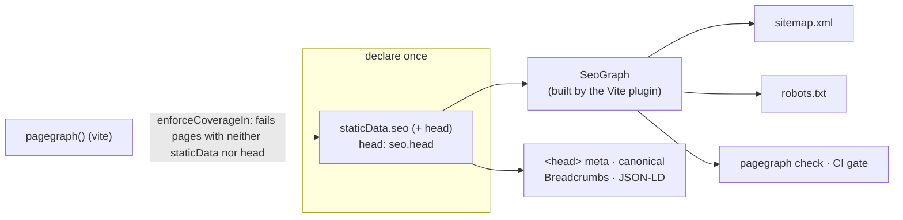

PageGraph asks each route to declare its SEO policy and head once, in `staticData.seo`. Everything else comes from that declaration: the `<head>`, the sitemap, `robots.txt`, breadcrumbs, JSON-LD, cross-links and the CI check. This page explains the model behind that and why it is built this way.

## Why declare on the route

SEO facts tend to be repeated. A page's title appears in its head, in the sitemap entry, in a JSON-LD block and in the cards other pages render for it. When a route is renamed or a description changes, each copy has to be found and updated by hand, and the copies drift.

PageGraph keeps one copy beside the route that owns it. The graph and the checks read the same `staticData.seo.head` that `seo.head` renders, so the page and the graph cannot disagree. The `pagegraph()` Vite plugin builds the graph once per build, and on change in dev, and ships it to the server runtime as data. The runtime never rebuilds it.



## Nodes and typed edges

`buildSeoGraph` walks the route tree and produces nodes, one per public URL, and typed edges between them:

- `crumb-parent`: breadcrumb ancestry.
- `related`: deliberate cross-links.
- `redirect`: declared with `redirectTo`.
- `collection-member`: ties collection instances into the graph.

Because links are edges, a rule such as "every `related` target exists" is a graph query. A `related` edge to a path with no node is a `dead-edge` violation, and it surfaces in `pagegraph check` instead of as a 404.

## Collections

Dynamic pages, such as blog posts rendering through `/blog/$slug`, enter as collections. A parameter route never enters the sitemap itself. Its pages come from a collections module, and instances inherit the parameter route's declared policy, so declarations stay the single source of truth.

```ts
const blogCollection: SeoCollection = {
  route: "/blog/$slug",
  source: "blog",
  instances: posts.map((p) => ({
    path: `/blog/${p.slug}`,
    title: p.title,
    description: p.description,
    publishedAt: p.date,
  })),
};
```

Each sitemap entry's `<lastmod>` is the page's last declared change: an instance's `modifiedAt`, else its `publishedAt`, or a route's `modifiedAt`. A parameter route's date is never inherited by its instances. Undated pages emit no `<lastmod>`.

## Typed paths

Augment `Register`, the same pattern TanStack Router uses, and `related` and `redirectTo` are typed against your real route tree. A renamed route becomes a compile error, not a dead link.

```ts
declare module "pagegraph" {
  interface Register {
    paths: FileRouteTypes["fullPaths"];
    kinds: "page" | "article" | "hub";
  }
}
```

`kinds` is the app's own taxonomy. Nothing in the graph branches on it.

## Structural and editorial rules

`checkGraph` runs every rule against the graph and returns violations at two severities.

**Structural** violations are internally broken declarations. They fail `pagegraph check` with exit 1. Examples are dead or duplicate edges, path collisions, a redirect in the sitemap, a sitemap and noindex contradiction, a `related` target with no `link` card, an instance without a title, a date that is not ISO 8601, an unmet contextual-link coverage rule, and a published URL the rendered `robots.txt` disallows.

**Editorial** violations are quality smells. They are reported without failing. Examples are duplicate titles and descriptions, descriptions outside the 50 to 160 character range, and pages older than the freshness policy.

The [check rules reference](/docs/reference/check-rules) lists each rule.

## What the graph cannot see

The graph knows declared heads and collection instances. It does not know what a dynamic `head()` computes at request time, or what a component renders. A passing `pagegraph check` without `--site` therefore says nothing about served HTML. Headings, JSON-LD and visible text are verified by inspecting rendered HTML with `check --site`, which is covered in [Gate CI with pagegraph check](/docs/guides/ci-check).

## Where drift surfaces

Each gate catches a different kind of broken declaration: typed paths at type check, the Vite build's evaluation and coverage gates, `pagegraph check` for structural and editorial rules, and `pagegraph links verify` on the served site. The coverage gate is opt-in. With `routeConfig.enforceCoverageIn`, a page in those route groups that declares neither `staticData` nor `head` fails the build. See [Enforce route coverage in Vite](/docs/guides/coverage-gate).
